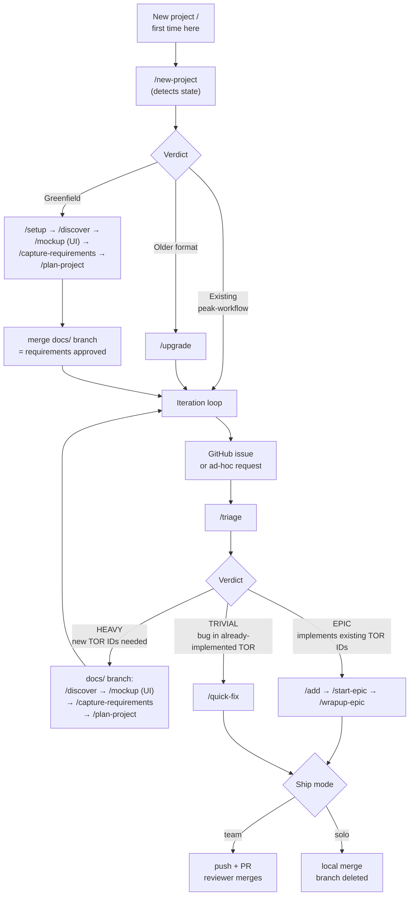

# Peak Workflow

> All slash commands belong to the `peak-workflow` plugin. This README uses the short form (`/discover`, `/start-epic`, etc.) for readability; invoke them with the full form (`/peak-workflow:discover`, `/peak-workflow:start-epic`, etc.) or use the short form if no other plugin uses the same skill name.

## Prerequisites

- **Claude Code** with this marketplace added.
- **Python 3.11 or newer** (standard library only; 3.11 brings `tomllib`). Every skill calls the
  plugin's helper, `scripts/tor-lifecycle`, which looks for `python3`, then `py -3`, then `python`,
  and prints an install hint when none is new enough. `/setup` checks for it. On Windows, run
  Claude Code from Git Bash.

## Where do I start?

```
                Is there an existing project here?
                            │
              ┌─────────────┴─────────────┐
              │                           │
              ▼                           ▼
       No (greenfield)          Yes — on peak-workflow
              │                           │
              ▼                           ▼
    /peak-workflow:setup        older format? → /peak-workflow:upgrade
              │                           │
              ▼                           ▼
          /discover               /triage  or  /status
              │                           │
              ▼                           │
      /mockup (UI apps)                   │
              │                           │
              ▼                           │
    /capture-requirements                 │
              │                           │
              ▼                           │
        /plan-project                     │
              │                           │
              ▼                           ▼
         iterate via /start-epic / /wrapup-epic / /quick-fix
```

**If unsure, run `/peak-workflow:new-project`** — it detects project state and dispatches to the right entry point automatically.

## Greenfield Quick Start

```
/peak-workflow:new-project           → (optional) detect state, dispatches the rest
/peak-workflow:setup                 → audit CLAUDE.md, stub docs, create develop, offer to publish to GitHub
/peak-workflow:discover              → creates docs/ branch, produces vision + ConOps
/peak-workflow:mockup                → (UI projects) screen inventory, flows, grayscale wireframes; concretizes ConOps steps
/peak-workflow:capture-requirements  → derives TOR requirements on the same docs/ branch
/peak-workflow:plan-project          → derives epics from TOR IDs on the same docs/ branch
[merge docs/ branch]                 → requirements and plan baseline approved
/peak-workflow:start-epic <id>       → implement first epic (tasks = user stories per TOR ID)
/peak-workflow:wrapup-epic <id>      → independent TOR verification, ship
```

> **Why run setup first?** `/discover` reads `CLAUDE.md` for project context, and `start-epic` /
> `wrapup-epic` depend on the Verification & Quality Gates section that `setup` populates.
> Running discover without setup means quality gates aren't in place until after the planning
> session — and on a small project, that gap can go unnoticed until the first wrapup fails.

## Brownfield — existing project, no peak-workflow yet

If your project pre-dates peak-workflow, run the greenfield path in **brownfield mode**: `/discover` and `/capture-requirements` both detect
that vision/ConOps and TOR files already exist (or don't) and adapt accordingly.

```
/peak-workflow:discover              → brownfield: creates docs/ branch, updates vision + ConOps
/peak-workflow:mockup                → (UI projects) screen inventory, flows, grayscale wireframes; concretizes ConOps steps
/peak-workflow:capture-requirements  → brownfield: appends new TOR IDs, archives changelog
/peak-workflow:plan-project          → brownfield: new epics for unplanned TOR IDs
[merge docs/ branch]                 → delta requirements and new epics approved
/peak-workflow:start-epic <id>       → implement new epics
```

## Upgrading an existing project

Each project records the format of its peak-workflow files in `docs/.peak-workflow.toml`
(`setup` writes it; a project without one is on format 0). When a plugin update needs a newer
format, every command stops and points to:

```
/peak-workflow:upgrade
```

It applies numbered, forward-only steps on a `docs/upgrade-format-N` branch, one commit per step
(or per phase), shows each step before applying it, and warns about feature branches in flight that
touch the files a step rewrites. `status` and `triage` still run, with a banner, while a project is
behind. Merge the upgrade branch like any planning change (merge = approval).

**From 2.1 to 3.0** (format 0 → 2), two steps run:

1. **0001 epic provenance** — backfills `**Planned by:**` / `**Planned:**` / `**Plan branch:**`
   from git (`—` where git cannot tell) and adds `owner: —` to sidecars.
2. **0002 requirements lifecycle** — turns lifecycle notes in feature files and ad hoc sidecar keys
   into Change Records (you approve one classification table), strips notes and titles (every
   surviving requirement's fingerprint must stay identical), seeds `verified:` fingerprints from
   each Complete epic's completion commit, and ends with a health report grouped by epic.

Requirements edited after they were verified now show as **Changed since verified**; `/status`
lists them by epic. Settle each one with the decision test: a meaning change →
`/peak-workflow:capture-requirements <TOR-ID>`; otherwise `/peak-workflow:wrapup-epic <id> reverify`.
Epics still in flight can be skipped; a later `/upgrade` run catches them up once they merge.

## Philosophy

Peak Workflow is a requirements-driven development lifecycle in the spirit of DO-330 TQL-5. The core principle: **requirements are the ground truth**. Tests are derived from requirements — not from implementation. You cannot verify "a bad implementation is correctly bad" when the verification baseline is independent of the code.

The formal requirements baseline lives in Gherkin-style `.feature.md` files with TOR requirement IDs (`TOR-NN-XXXXXXX`). Each TOR ID is:
- The **acceptance criterion** for an epic (an epic's spec lists the TOR IDs it implements)
- The **verification procedure** for wrapup (the Given/When/Then defines exactly what a passing test must demonstrate)
- A **stable foreign key** once merged to develop (referenced by epic specs, tests, and handoffs): a
  change in meaning gets a new ID, never a new meaning under the old one

> **On ceremony overhead:** the discover → requirements → planning sequence amortizes as the
> project grows — every new request routes through `/triage`, which tells you whether it needs
> new TOR IDs (HEAVY), implements existing ones (EPIC), or is a trivial bug (TRIVIAL).

### Vertical slices — one capability per epic

**An epic is a vertical slice.** A TOR is a black-box, user-observable behavior, so the epic
that owns it must deliver it end to end — schema, service, endpoint, screen — inside that one epic. A
"backend epic" can never satisfy a UI-observable Then clause; it can only defer it, and every
deferral is a verification gate the operator has to sit through.

`/plan-project` therefore starts with **one walking-skeleton epic** (scaffolding, build, CI, and
the tool-hygiene TORs as the thin end-to-end path that sets the architectural pattern), then
forms one slice per capability, seeded from the feature files. The rule is **whole-capability**:
every TOR in an epic is fully realizable inside it; if one isn't, the slice widens — unless an
earlier epic already owns that code, which is then a dependency, not a reason to widen. Prefer the
fewest epics that satisfy that rule — each epic pays a fixed cost (plan, blind wrapup session,
PR), and an oversized epic is cheap to split later.

**The 25% context rule is still yours to keep.** Work from a small context — around 25% — because
a crowded context is where sloppy tests and missed requirements come from. Claude Code cannot
see context usage at planning time, so the planner no longer sizes epics to it; you enforce it
where it can be measured. Watch the status line's context meter, and when a session gets heavy,
roll to a fresh one with peak-workflow's `/newtask` (or your preferred handoff skill) and
continue the same epic. The epic is not too big — the session is.

### UX Baseline — web and desktop apps get the same treatment as CLIs

CLI tools already have a verifiable operability baseline: the **Tool Hygiene & Operability**
section of `CLAUDE.md` declares version flags, exit codes, and error-message standards, and
`/capture-requirements` turns each line into a baseline TOR. Web apps and desktop apps get the
same chain through the **UX Baseline** section that `/setup` writes for UI project types:

| Stage | What happens |
|---|---|
| `/setup` | Declares the design system (default shadcn/ui on Tailwind v4, themed only through CSS-variable tokens in the global stylesheet) and the interaction conventions every screen must meet — Screen states, Keyboard & focus, Forms, Destructive actions, Progress feedback, Layout floor, Contrast, Reduced motion, Navigation, and for desktop apps the Desktop conventions. Every line has a default a non-technical user can accept. |
| `/capture-requirements` | Derives one Playwright-observable baseline UX TOR per active line, ahead of the domain TORs. |
| `/plan-project` | The walking-skeleton epic owns those TORs: it installs the design system, builds the app shell, and ships one reference screen that proves them. Later slices compose from the shell; none installs a second component library. |
| `/start-epic` | A Design pass invokes the installed design skills; UI middle steps name each screen, its four states, and the design tooling used. |
| `/wrapup-epic` | Runs the UX Baseline check as a quality gate on every screen a UI epic adds or changes — a FAIL is Fix now / Stop, never deferred. |

### Design process — from first sketch to shipped screen

Most people building an app have no design background, so design is a planned part of every UI
project rather than something left to chance:

1. **See the screens first — `/mockup`.** Runs between `/discover` and `/capture-requirements`.
   It turns the ConOps scenarios into an `S-NN` screen inventory, per-scenario flows, and one
   grayscale wireframe per screen (loading / empty / error / populated), laid out on standard
   shadcn app shells. `wireframes/index.html` opens in your browser for up to three rounds of
   changes. ConOps steps are then rewritten to name each screen and control, so TORs cite them.
   Wireframes are grayscale on purpose: layout and behavior now, look and feel later.
2. **Declare the UX rules once — `/setup`.** The UX Baseline above, plus the tooling: on shadcn
   stacks it installs the shadcn/ui skills and the `shadcn` MCP server (component lookup) and
   commits them for the team; it also recommends `frontend-design@claude-plugins-official` and,
   for web UIs, `playwright-cli`. Restart Claude Code afterwards and approve the `shadcn` server.
3. **Build with the best tools — `/start-epic`.** Every UI epic's plan has a numbered **Design
   pass** before any screen work. It invokes whichever design skills are installed *at that
   moment* (`frontend-design`, a brand kit, `dataviz` when charts are involved, shadcn) and looks
   each component up through the shadcn MCP tools before composing it.
4. **Check every screen — `/wrapup-epic`.** The UX Baseline gate and wireframe-fidelity check run
   on every screen the epic touched. The handoff and the report show `Design skills used:`.

**Precedence:** TOR Given/When/Then > wireframe layout > UX Baseline and design tokens >
design-skill choices. Palette, typography, and brand are never TORs; theme changes go in the
token file only.

**Stack defaults come from the reference sheets.** Three sheets ship with the plugin under
[`references/`](references/): [`bun-static-spa-stack.md`](references/bun-static-spa-stack.md)
(browser-only apps — React SPA, IndexedDB via Dexie, GitHub Pages, no server),
[`bun-web-app-stack.md`](references/bun-web-app-stack.md) (web apps and services — Bun runtime,
Hono, React SPA, SQLite, S3, one Docker container) and
[`bun-electron-desktop-stack.md`](references/bun-electron-desktop-stack.md) (desktop apps —
Bun toolchain, Electron shell, electron-vite, React + shadcn/ui, better-sqlite3). When the
tech-stack answer is thin, `/setup` reads the matching sheet's Stack Summary and takes those
picks — there is no separate default list — and `/plan-project` builds the greenfield walking
skeleton from the sheet's repository layout and config files instead of running a scaffolder.
The user sees the stack in one plain-language confirmation and can override any layer.

**`/setup` asks little and defaults the rest.** It asks only what the user alone knows — what the
product is, what kind of thing it is (CLI tool, web app, desktop app, service, library, embedded
device software, or a hybrid), the shape questions, sign-in, and any language or device they must
use. Commands, test directories, logging, versioning, git, and release conventions come from the
existing code, the sheet, or a per-language toolchain table, and are shown once for confirmation.
Anything nothing can decide yet is written `TBD — set by the walking-skeleton epic`, and the
skeleton resolves it.

**The sheet is chosen by product shape, not project type.** Before reading any sheet, `/setup`
asks up to five questions in plain language — does the information need to follow the person to another
device, does anyone sign in, do people attach files, does anything update on its own, does the
product hold a secret of its own. A Web app answering "no" to all five is a static SPA and gets
that sheet; any "yes" gets the web-app sheet. The answers are recorded in `CLAUDE.md`, and rows
they drop are written `N/A — <reason> (shape Q<N>)` so `/plan-project` reads them as decisions
rather than gaps. `/discover` re-checks the answers against the ConOps scenarios once the product
is actually described, and asks before changing anything.

For an **existing** project the sheets are reference only: its `CLAUDE.md` Tech Stack always
wins, differing from a sheet is never a gate failure or a TOR, brownfield planning ignores the
sheets entirely, and no skill proposes re-platforming a codebase to match one. Their *Stack
Summary* tables are still useful there as a checklist of every layer an app of that shape has
to handle. See [`references/README.md`](references/README.md).

## Skills

Grouped by lifecycle phase. The same commands are listed in `CLAUDE.md`'s skill inventory.

### Bootstrap

| Command | Purpose |
|---|---|
| `/new-project` | **Front door for newcomers.** Reads the format stamp (fresh project, existing peak-workflow project, or one that needs `/upgrade`) and dispatches to the right entry point. Writes no state files. |
| `/setup` | Audits `CLAUDE.md` (Project Overview, Product shape, Tool Hygiene & Operability, UX Baseline for UI projects, Security Baseline, quality gates), asks only what the user alone knows and defaults the rest behind one confirmation, stubs `architecture.md`, `design-notes.md`, and `docs/requirements/README.md`, writes the format stamp `docs/.peak-workflow.toml` and checks for Python 3.11+, installs the shadcn skills and MCP server on shadcn stacks, recommends companion skills, creates `develop`, and offers to publish to GitHub. **Run once per project, before `/discover`** (re-run to pick up new sections). |

### Plan

| Command | Purpose | Branch / Status |
|---|---|---|
| `/discover` | Adaptive interview that produces `product-vision.md` + `concept-of-operations.md` | Creates `docs/{task-short-name}` branch |
| `/mockup [scenario]` | Low-fidelity UX prototyping for Web / Desktop / UI-Hybrid projects — derives an `S-NN` screen inventory, per-scenario flows, and grayscale HTML wireframes (shadcn app-shell layouts, reviewed in the browser) from the ConOps, then rewrites ConOps steps to name screens and controls so TORs cite them | Continues on `docs/` branch |
| `/capture-requirements [TOR-ID]` | Derives TOR requirements (`.feature.md` files + `.feature.tracing.json` sidecars) from vision + ConOps; amends, retires, or records pending changes with Change Records. With a TOR ID, settles one requirement (changed since verified, edited without a record, disputed, or a requested change) | Continues on `docs/` branch (TOR-ID mode: its own `docs/amend-<tor-id>`) |
| `/plan-project` | Derives implementation plan (phases, epics, Requirements Anchors specs) from TOR requirements | Continues on `docs/` branch |
| `/add <description>` | Adds new epic(s) referencing existing TOR IDs | — (writes planning docs) |
| `/triage <issue\|description>` | Advisory routing — HEAVY (needs new TOR IDs) / AMEND (changes one existing requirement, no vision or ConOps impact → `/capture-requirements <TOR-ID>`) / EPIC (implements existing TOR IDs) / TRIVIAL (bug in an already-implemented TOR) | — (writes no files) |

### Implement

| Command | Purpose | Branch / Status |
|---|---|---|
| `/start-epic <id>` | Implement the epic — shows an epic card (who planned it, phase, owner) and confirms before branching, loads TOR Given/When/Then, creates user-story tasks, implements, verifies | Not Started → In Progress → **Implemented** |
| `/wrapup-epic <id>` | Independent review — verifies each TOR's Given/When/Then is satisfied, asks fix-now-or-defer on every gap, closes out, ships; runs on Opus in a fresh session | Implemented → **Complete** |
| `/wrapup-epic <id> reverify [TOR-…]` | Re-checks a Complete epic's stale requirements (Changed since verified or Verification failed) and updates their `verified:` / `unverified:` lines; the epic stays Complete | `hotfix/verify-epic-<id>-<short-name>` |
| `/pause` | Stop mid-epic, save progress | In Progress → **Paused** |
| `/quick-fix <issue\|description>` | Lightweight path for trivial bugs in already-implemented TORs — creates `hotfix/` branch, implements, ships. May carry one owner-approved, non-Safety requirement change (reword, or supersede + same-branch reverify) | Not tracked in implementation plan |

### Inspect

| Command | Purpose |
|---|---|
| `/status` | Read-only dashboard — behind-origin warning, what teammates changed since your last commit, epic progress, Requirements Coverage over live requirements, Changed Since Verified by epic, Requirements Health (findings A–F, Disputed), active work with owners, a Ready to Start table (never a blind single pick), next actions |

### Maintain

| Command | Purpose |
|---|---|
| `/refresh-docs` | Refresh `architecture.md` + `design-notes.md` to match the as-built codebase |

### Upgrade

| Command | Purpose |
|---|---|
| `/upgrade` | Brings an older project's files to this plugin's format — numbered steps, each previewed, one commit per step on a `docs/upgrade-format-N` branch |

## Choosing a Path

The lifecycle has two stages: a one-time bootstrap to get the requirements baseline in place,
and a recurring iteration loop for incoming work.



## Branch Families

| Branch | Pattern | Scope |
|---|---|---|
| Planning | `docs/{task-short-name}` | discover → mockup → capture-requirements → plan-project → add (cohesive; merge = approval) |
| Implementation | `feature/epic-<id>-<short-name>` | start-epic → wrapup-epic |
| Quick fix | `hotfix/<slug>` or `hotfix/issue-<N>-<slug>` | quick-fix |

All three branch families are cut from `develop` and merge back into it; `main` receives only
release merges. `setup` creates `develop`, and when you let it publish the project to GitHub it
makes `develop` the default branch and protects `main` and `develop` (pull request + 1 approval,
no force-push, no deletion — administrators may bypass).

**Develop-branch invariant:** anything on `develop` is approved. The merge event (solo merge or team PR) is the approval signature.

## TOR Requirement IDs

Format: `TOR-{NN}-{XXXXXXX}`

| Part | Meaning |
|---|---|
| `TOR` | Tool/Product Requirements prefix |
| `{NN}` | Feature file number, 2-digit zero-padded (e.g., `01`). **Stable once assigned.** |
| `{XXXXXXX}` | 7-character random alphanumeric (parallel-safe, collision-resistant) |

Example: `TOR-01-Afs657G` lives in `docs/requirements/01-cli.feature.md`.

TOR IDs are **stable once merged to develop** and **never reused.** They are foreign keys — epic specs, tests, and handoffs all reference them by ID. A changed meaning gets a new ID through a supersede; see [Requirements lifecycle](#requirements-lifecycle).

## Epic Spec Structure

Epic specs no longer contain prose Acceptance Criteria or Verification sections. Instead:

```markdown
# Epic a3f2K7p: CLI Version and Help Flags

**Phase:** 1 — Foundation
**Status:** Not Started
**Dependencies:** —
**Planned by:** tschavey
**Planned:** 2026-09-04
**Plan branch:** docs/cli-baseline

---

## Description

Implements the `-v` / `--version` and `--help` command-line flags. Users need to confirm
tool installation and access usage documentation from the command line.

## Requirements Anchors

> The TOR requirement IDs listed below are the acceptance criteria and verification baseline
> for this epic. Each ID maps to a Gherkin scenario in the referenced feature file.
> `/peak-workflow:start-epic` reads each TOR's Given/When/Then to drive implementation and tests.
> `/peak-workflow:wrapup-epic` independently verifies each TOR's Given/When/Then is satisfied.

| TOR ID | Feature File |
|--------|--------------|
| TOR-01-Afs657G | `docs/requirements/01-cli.feature.md` |
| TOR-01-Bcd2345 | `docs/requirements/01-cli.feature.md` |

Titles live only in the feature file; skills print the current title when they show a requirement.

## Key Components

- `src/cli.py` — add version and help flag handlers
- `tests/test_cli.py` — TOR-based tests
```

On UI projects that ran `/mockup`, a UI epic's spec also carries an optional `## Screens`
section after Requirements Anchors — one row per `S-NN` the epic delivers, with its wireframe
path and states; each screen belongs to exactly one epic.

## Status Sidecar Format

```
status: Not Started
owner: —
implemented: —
completed: —
handoff: —
requirements: TOR-01-Afs657G, TOR-01-Bcd2345
waived: TOR-01-Bcd2345 → B9xQr2z
verified:
  TOR-01-Afs657G: 3f9a0c21d7be
```

`verified:` (written at wrapup), `unverified:` (a reverify FAIL or a requirement recorded as
pending), and `reverified:` are written only by the helper's `mark` command, never by hand. Each
`verified:` value is the requirement's fingerprint when it passed.

The `owner:` line is set by `start-epic` to the person who starts the epic (`git config user.name`).
It travels with the feature branch, so it reaches `develop` when the epic merges; until then,
`start-epic` warns when the epic's branch already exists on origin under someone else's commits.
The spec's `**Planned by:**` / `**Planned:**` / `**Plan branch:**` header lines record who planned
the epic; specs that predate them show `—`.

The `waived:` line is optional — `wrapup-epic` writes it when a TOR was waived to a successor
epic, and `status` credits that TOR's coverage to the successor.

The `requirements:` field is how `/peak-workflow:status` computes the Requirements Coverage dashboard.

## Artifact Hierarchy

```
docs/product-vision-planning/
  product-vision.md           ← product intent (written by /discover)
  concept-of-operations.md    ← user scenarios (written by /discover; steps name screens after /mockup)
  ux/screens.md               ← S-NN screen inventory, states, per-scenario flows (written by /mockup, UI projects)
  ux/wireframes/S-NN-*.html   ← grayscale wireframes, one per screen, four states (same)
  ux/wireframes/index.html    ← browser index of every wireframe (same)
  ux/README.md                ← how to open the wireframes (same)
  changelogs/                 ← brownfield discovery changelogs

docs/requirements/
  NN-{name}.feature.md        ← TOR requirements (written by /capture-requirements)
  NN-{name}.feature.tracing.json  ← TOR → vision/ConOps linkage (written by Haiku sub-agent)
  changes/YYYY-MM-DD-XXXXXXX.toml  ← Change Records, one per lifecycle decision, write-once
  README.md                   ← conventions (written by /setup)

docs/implementation-plan/
  phase-N-*/index.md          ← epic registry per phase (epic ID, name, dependencies)
  phase-N-*/epic-<id>-*.md    ← epic specs with Requirements Anchors tables
  status/epic-<id>.md         ← status sidecar (status, implemented, completed, requirements:)
  session-handoffs/           ← implemented and complete handoff files
  README.md                   ← lifecycle prose (never written by skills after creation)

docs/architecture.md          ← system architecture (stubbed by /setup, refreshed by /refresh-docs)
docs/design-notes.md          ← design decisions (same)
docs/.peak-workflow.toml      ← format stamp + [lifecycle] settings (written by /setup, moved by /upgrade)
```

## Requirements & Verification

The key distinction between peak-workflow and a typical Agile workflow:

| | Typical | Peak Workflow |
|---|---|---|
| Acceptance criteria | Prose checkboxes in the spec | TOR IDs referencing Gherkin scenarios |
| Test derivation | Implementer decides what to test | Given/When/Then dictates what the test must verify |
| Wrapup baseline | Did the implementation match the spec? | Does the implementation satisfy the TOR Given/When/Then? |
| Requirements source | Implicitly distributed across docs | Formally captured in `docs/requirements/*.feature.md` |
| Requirements approval | N/A | Merge of `docs/` branch (solo or team PR) |

## Requirements lifecycle

Feature files show only present truth. Every change to a merged requirement is one small,
write-once **Change Record** in `docs/requirements/changes/`; git holds the old text.

| Kind | When | Effect |
|---|---|---|
| `reword` | Same meaning, better words, citing tests still pass | Same ID; shows **Verified (reworded)** with test evidence |
| `supersede` | The meaning changes (even if never verified) | New ID in place; the successor starts unassigned, so `/plan-project` or `/add` plans it |
| `retire` | The requirement goes away | ID removed for good; `removal = "code"` asks for a removal epic |
| `pending` | Known wrong, not yet decided | Requirement is **Disputed** (not counted Verified); overdue after 30 days, at once for `# Safety` |
| `uphold` | The owner decides a disputed requirement was right | Closes the dispute with no text change |

**Where amendments happen.** On a `docs/` branch with `/capture-requirements` (all kinds, or one
requirement with `/capture-requirements <TOR-ID>`); inside an epic at `/start-epic` (supersede only);
at `/wrapup-epic` Step 1.4b (amend or record as pending); and in `/quick-fix` (reword, or supersede
plus a same-branch reverify). Never for a Safety requirement outside a `docs/` branch.

**Fingerprints and re-verification.** Wrapup saves each passing requirement's fingerprint (a
12-character checksum of its normalized text) in the epic's sidecar. When the text later changes
without a reword, `/status` shows it **Changed since verified** under its epic. Resolve it with
`/capture-requirements <TOR-ID>` (meaning changed, or restore the verified text) or
`/wrapup-epic <id> reverify` (still the same requirement). A reverify FAIL marks it
**Verification failed**; fix the code with `/quick-fix`, then reverify again.

**Health check.** `/status`, `/start-epic`, `/wrapup-epic`, `/quick-fix`, `/triage`, and
`/capture-requirements` run the helper's `check`. Findings: **A** edited without a record, **B**
removed without a record, **C** citation of an unknown ID, **D** changed since verified, **E**
retired or superseded ID still cited, **F** housekeeping and disputes. `/wrapup-epic` and
`/quick-fix` block only on A, B, or C their own branch created, and offer the fix.

**Settings.** `docs/.peak-workflow.toml` `[lifecycle] disputed_threshold_days` (default 30) sets when
a dispute is overdue. Safety requirements are always 0.

## Key Files

| File | Purpose |
|---|---|
| `CLAUDE.md` | Auto-loaded every session — project context, tech stack, quality gates |
| `docs/product-vision-planning/product-vision.md` | Product vision (written by `/discover`) |
| `docs/product-vision-planning/concept-of-operations.md` | Operational scenarios (written by `/discover`) |
| `docs/product-vision-planning/ux/` | Screen inventory and wireframes (written by `/mockup`, UI projects) |
| `docs/requirements/*.feature.md` | TOR requirements — Gherkin feature files (written by `/capture-requirements`) |
| `docs/requirements/*.feature.tracing.json` | TOR → vision/ConOps linkage (written by Haiku sub-agent) |
| `docs/requirements/changes/*.toml` | Change Records — reword, supersede, retire, pending, uphold |
| `docs/.peak-workflow.toml` | Format stamp and `[lifecycle]` settings |
| `docs/implementation-plan/phase-N-*/index.md` | Per-phase epic registry — append-only |
| `docs/implementation-plan/status/epic-<id>.md` | Per-epic sidecar — status + requirements: field |
| `docs/implementation-plan/phase-N-*/epic-<id>-*.md` | Epic specs (Requirements Anchors format) |
| `docs/implementation-plan/session-handoffs/` | Implemented and complete handoff files |
| `docs/architecture.md` | System architecture (stubbed by `/setup`, refreshed by `/refresh-docs`) |
| `docs/design-notes.md` | Design decisions (same as above) |
| `.claude/skills/`, `.mcp.json` | shadcn/ui skills and the `shadcn` MCP server (installed by `/setup` on shadcn stacks, committed) |
